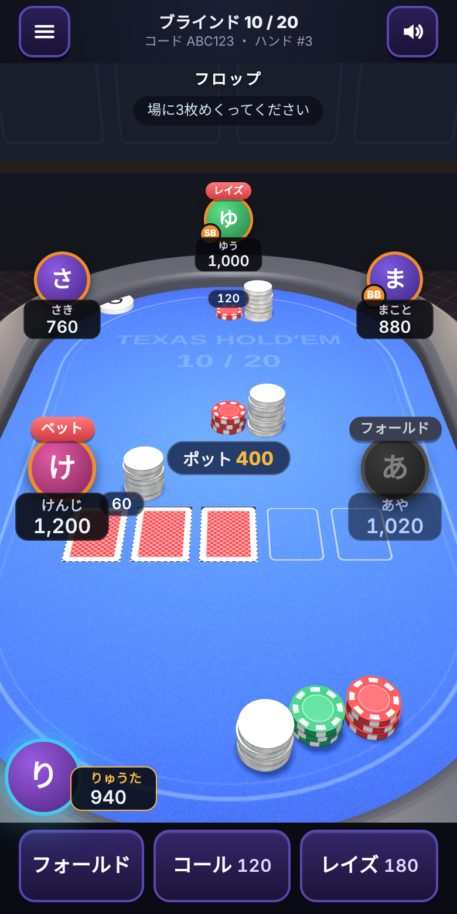
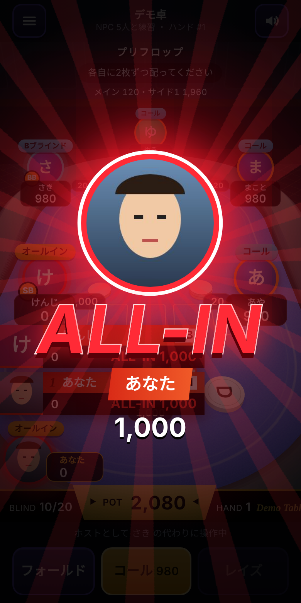
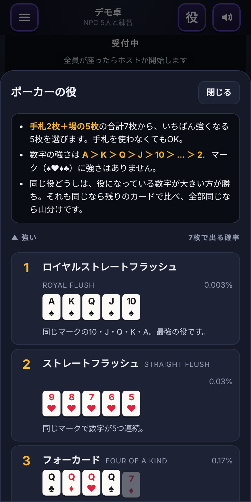

# みんなのチップ卓

リアルのトランプで遊ぶテキサスホールデム用の、チップ管理アプリです。
カードは本物を配り、チップのやり取りだけを各自のスマホで行います。全員の画面がリアルタイムで同期します。

<p>
  
  
  
</p>

## できること

- **一人称の3Dテーブル**：自分の席から卓を見る視点（three.js）。チップは立体の山で積まれ、ベット・ポット回収・勝者への移動がアニメーションします。
- **各自のスマホで操作**：自分の番にフォールド／チェック・コール／レイズ。レイズは縦スライダーと、ポット比・BB倍率のおすすめ額ボタン付き。
- **ゲーム進行の自動計算**：ブラインド、ディーラーボタン、最小レイズ額、サイドポット、引き分けの山分け、ブラインドの自動増加。
- **テレビ中継風の演出**：下部のPOTテロップ、選手テロップ、オールイン時に全員の画面中央へ顔写真と「ALL-IN」、勝者には「WIN」。
- **顔写真**：スマホのカメラで撮ってアイコンに設定できます。
- **役の表**：初心者向けに、10種類の役を見本カードと出る確率付きで表示します。
- **デモモード**：あなたとNPC 5人の卓で、サインインなしで流れを試せます。
- **ホスト機能**：1つ前に戻す、チップ調整（リバイ）、退席、ゲーム終了、テーブル削除（使わない卓は24時間で自動削除）。
- **ディーラーモード**：ホストは画面右上の「ディーラー」をONにしたときだけ、ほかの人の番を代わりに操作できます（初期はOFF）。

## 使い方

1. ホストが名前・初期チップ・ブラインドを入れて「テーブルを作成」。6文字のコードが出ます。
2. 友だちはページを開いてコードを入れ、空いている席をタップして座ります。
3. 全員そろったらホストが「ゲーム開始」。
4. 画面の指示（2枚ずつ配る、場に3枚めくる…）に合わせて、実物のトランプを配ります。
5. 自分の番に、自分のスマホでベットします。
6. ショーダウンで勝者をタップして「精算する」。次のハンドへ進みます。

## 遊び方は2通り

### GitHub版（アカウント不要）
**https://benkyoryuta-jpg.github.io/poker/** を開くだけで遊べます。

- テーブルを作ったら、メニューの「招待リンクをコピー」で友だちに送ります。リンクを開くだけで同じ卓に入れます。
- 同期には無料の公開MQTTサーバー（`broker.emqx.io`）を使っています。卓の状態はサーバーに保存されるので、途中から開いた人にも今の状態が出ます。
- 公開サーバーなので、**コードを知っている人は誰でも卓を操作できます**。コードは遊ぶ仲間にだけ伝えてください。サーバーが混んでいると、同期が遅れたり切れたりすることがあります。

### Claude版
Claude のアーティファクト（claude.ai で公開するページ）として開くと、Claude の共有データベース（`window.claude.use("db")`）で同期します。参加者はそれぞれ Claude のアカウントが必要で、共有メニューから「編集者」として招待します。

どちらも同じ `index.html` で、開いた場所に合わせて同期の方法が自動で切り替わります。

## ファイル構成

```
index.html              アプリ本体（HTML・CSS・JavaScript を1ファイルに収録）
docs/screenshots/       README用の画面写真
```

外部から読み込むのは three.js（cdnjs、r128）、mqtt.js（unpkg、5.15.1、GitHub版のみ）、Google Fonts だけです。ビルドは不要です。

## 注意

このアプリはチップ計算とゲーム進行を補助するツールです。金銭や換金できる物を賭けることは法律で禁じられており、本ツールはそれを推奨しません。
